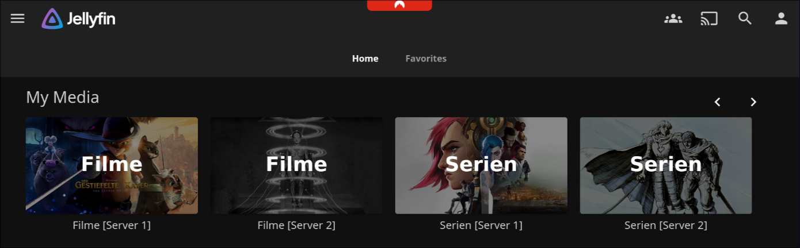
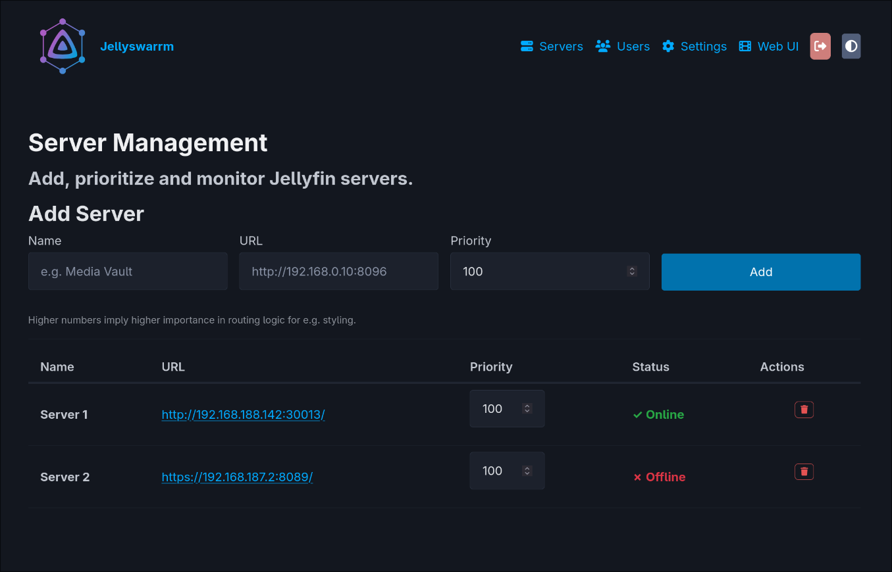
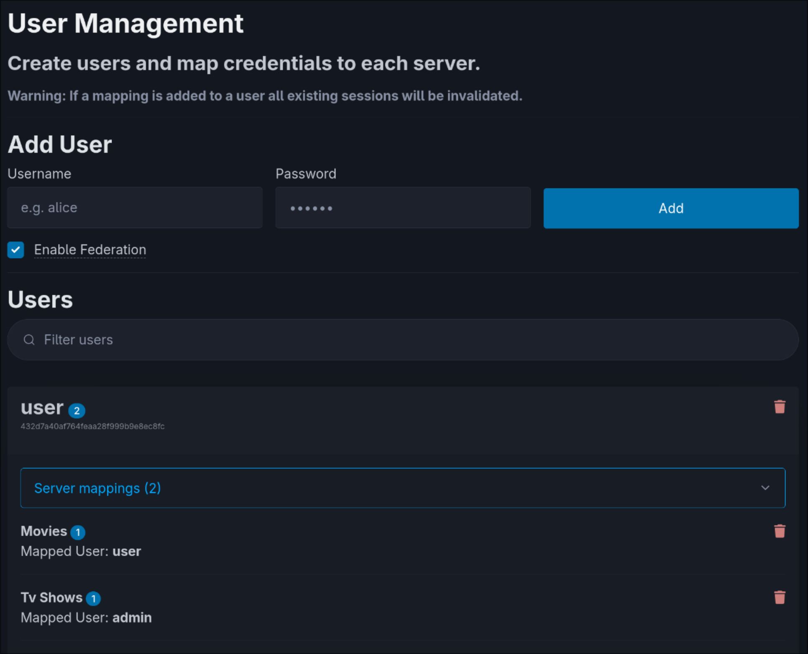
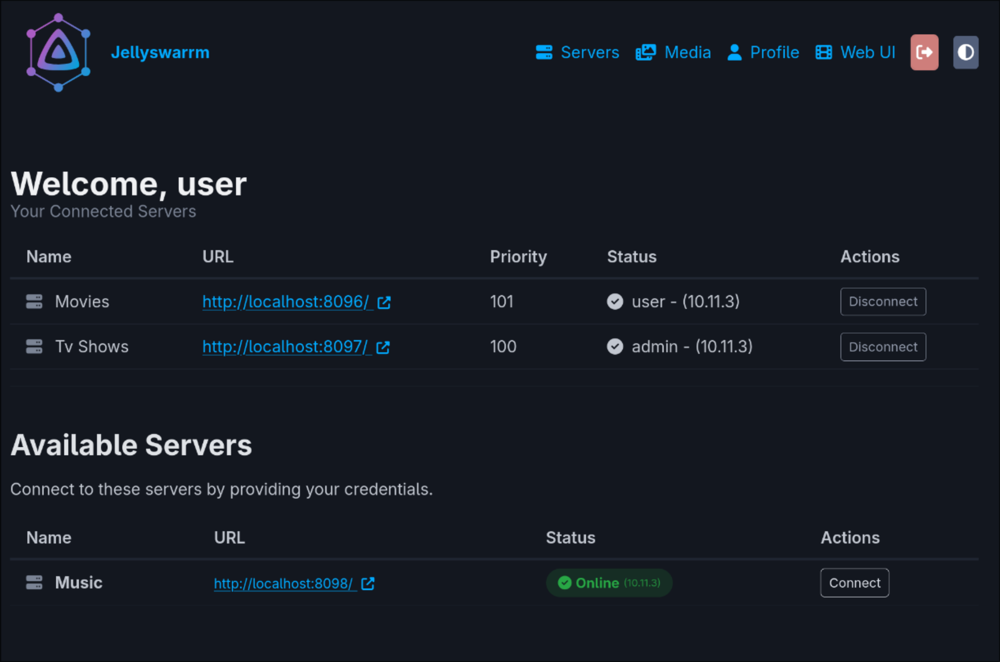

<h1 align="center">Jellyswarrm</h1>

<h3 align="center">Many servers. Single experience.</h3>

<p align="center">

<br/>
<br/>
<a href="https://www.gnu.org/licenses/old-licenses/gpl-2.0.html">

</a>
<a href="https://hub.docker.com/r/fivespeeddeasil/jellyswarrm">

</a>
</p>

Jellyswarrm is a reverse proxy that lets you combine multiple Jellyfin servers into one place. If you’ve got libraries spread across different locations or just want everything together, Jellyswarrm makes it easy to access all your media from a single interface.

> This is a friendly fork of [LLukas22/Jellyswarrm](https://github.com/LLukas22/Jellyswarrm). It keeps the upstream features and adds Single Sign-On, library merging and deduplication across servers, cross-server watch-state sync, a server switcher, encrypted credentials, safer upgrades and an end-to-end test suite. It ships the **Jellyfin 12.2 web client** and works with **Jellyfin 12.x and 10.11** backends, mixed freely.

---

<p align="center">
  <!-- Full-width library view -->
  
</p>

<p align="center">
  <!-- Side-by-side smaller views, same height -->
  
  
  
</p>

## Features

> [!WARNING]
> Jellyswarrm is still in **early development**. It works, but some features are incomplete or missing. For fork-specific issues, open one on [this repo](https://github.com/FancyWaifu/Jellyswarrm/issues); for upstream behaviour, [LLukas22/Jellyswarrm](https://github.com/LLukas22/Jellyswarrm/issues) is the right place.

### ✅ Working

* **Unified Library Access** – Browse media from multiple Jellyfin servers in one place.
* **Direct Playback** – Play content straight from the original server without extra overhead.
* **User Mapping** – Link accounts across servers for a consistent user experience.
* **API Compatibility** – Appears as a normal Jellyfin server, so existing apps and tools still work.
* **Server Federation** – Automatically sync users across connected servers.
* **User Page** – Personal dashboard for managing credentials and libraries.
* **QuickConnect** – Sign in on one device by approving the code from another authenticated device.
* **SyncPlay** – Watch together with your friends, with playback synced across all participants.
* **Per-Server Streaming Mode** – Choose `Redirect` or `Proxy` independently for each backend.

### ➕ Fork-Specific Additions

**Browsing across servers**
* **Merged libraries** – Same-type libraries from different servers (e.g. everyone's "Movies") appear as one library; paging, sorting, filters and genres work across the whole merged library.
* **Deduplication** – The same movie, series or episode on several servers shows up once (matched by provider IDs). Opt-in with `dedup_movies = true`.
* **Version picker** – For a deduplicated title, choose which server to stream it from.
* **Merged home rows** – *Continue Watching*, *Next Up* and *Recently Added* combine every server, including for newer clients (e.g. Android TV) that use `/UserItems/Resume`.
* **Server switcher** – Browse a single server's content on its own: open the user menu (your avatar, top right) and pick a server, or *All servers*.
* **Cross-server watch state** – Watched marks, resume positions and favourites follow you to the same title on your other servers, with a retry queue for servers that are offline (`watched_state_sync`, on by default).

**Sign-in & security**
* **Single Sign-On (OIDC)** – Bring your own identity provider; users pick it from a "Sign in with SSO" button. See [Single Sign-On (SSO)](#-single-sign-on-sso).
* **Encrypted credentials** – Stored server credentials and session tokens are encrypted with a generated `session_key`; local passwords are hashed with Argon2id.
* **Rate limiting** – Per-IP limits on Jellyfin logins, the management UI login and SSO account linking, with correct client IPs behind trusted proxies or Cloudflare (`trusted_proxies`, `trust_cf_connecting_ip`).
* **Hardened endpoints** – Login required for the server list, on-site-only redirects after login, item-id-only image proxying, security headers and CSP on the management UI.

**Running it**
* **Health checks** – `/health` and `/ready` endpoints (used by the Docker healthcheck); servers are checked before Jellyswarrm starts serving, and a slow or failing server is temporarily taken out of merged results and brought back automatically. See [health monitoring](./docs/health-monitoring.md).
* **Safe upgrades** – Before applying database migrations, Jellyswarrm backs up the database and config to `data/backups/pre-upgrade-<time>/`, with rollback instructions in the log. See [Upgrading](#upgrading).
* **Environment configuration** – Every config key can be set as `JELLYSWARRM_<KEY>`, including multi-word ones like `JELLYSWARRM_SESSION_KEY` and `JELLYSWARRM_PUBLIC_URL`.
* **SQLite WAL + tuning** – Concurrent reads, larger page cache, mmap I/O, performance indexes.

### ⚠️ In Progress

* **Audio Streaming** – May not function correctly (still untested in many cases).
* **Automatic Bitrate Adjustment** – Stream quality based on network conditions isn’t supported yet.
* **Media Management** – Features like adding or deleting media libraries through Jellyswarrm are not implemented yet.

---

## Deployment

The easiest way to run this fork is with the prebuilt [Docker image on Docker Hub](https://hub.docker.com/r/fivespeeddeasil/jellyswarrm) (`linux/amd64`).
Here’s a minimal `docker-compose.yml` example to get started:

```yaml
services:
  jellyswarrm:
    image: fivespeeddeasil/jellyswarrm:latest
    container_name: jellyswarrm
    restart: unless-stopped
    ports:
      - 3000:3000
    volumes:
      - ./data:/app/data
    environment:
      - JELLYSWARRM_USERNAME=admin
      - JELLYSWARRM_PASSWORD=jellyswarrm # ⚠️ Change this in production!
```

`latest` follows `main`; each release also gets a fixed tag (`sso26`, `sso27`, …). Pin a fixed tag so a restart never upgrades you by surprise.

> Prefer upstream's image? Use `ghcr.io/llukas22/jellyswarrm:latest` instead. You'll lose the fork-specific features but gain LLukas22's release cadence.

Once the container is running, open:

* **Web UI (setup & management):** `http://[JELLYSWARRM_HOST]:[JELLYSWARRM_PORT]/ui`
  – Log in with the username and password you set in the environment variables.
  – From here, you can add your Jellyfin servers and configure user mappings.

* **Bundled Jellyfin Web Client:** `http://[JELLYSWARRM_HOST]:[JELLYSWARRM_PORT]`

For advanced configuration options, check out the [ui](./docs/ui.md) and [configuration](./docs/config.md) documentation. Running behind a reverse proxy, Cloudflare or with SSO? See [reverse proxy, HTTPS & SSO](./docs/reverse-proxy.md).

### Upgrading

Everything Jellyswarrm needs lives in the data directory (`/app/data`): the database and `jellyswarrm.toml`. The config holds the `session_key` that encrypts stored credentials, so **back up the whole directory, keep it together, and never lose the key**: without it, every stored server password and session has to be entered again.

To upgrade, stop the container, back up the data directory, change the image tag, and start it again. Jellyswarrm makes its own backup to `data/backups/pre-upgrade-<time>/` before changing the database, and the log tells you how to roll back.

The SSO client secrets are encrypted with the admin password (`JELLYSWARRM_PASSWORD`). If you change that password, re-add your SSO providers in the **SSO** tab (identities stay linked).

### Kubernetes

Running on Kubernetes with a Service named `jellyswarrm`? Kubernetes injects `JELLYSWARRM_PORT=tcp://…` into the pod, which Jellyswarrm reads as its own setting. Add `enableServiceLinks: false` to the pod spec to stop it.

---

## 🔑 Single Sign-On (SSO)

Jellyswarrm can authenticate users against any standards-compliant **OpenID Connect (OIDC)** identity provider — bring your own. A **"Sign in with SSO"** button is added to the login screen; the user picks their provider and lands logged in.

* **Bring your own IdP** – register providers in the management UI (**SSO** tab), or preconfigure them in your config file.
* **Per-server providers** – optionally bind a provider to a specific backend, so the login picker *groups sign-in options by server*. Handy when every Jellyfin hoster runs their own IdP.
* **Account linking** – users self-link their existing Jellyswarrm account once at first login (so they keep their servers), and admins can link identities too.
* **Secure by construction** – Authorization Code flow with PKCE + nonce and full id_token validation (signature, issuer, audience, expiry). Identities are keyed on `(issuer, subject)`, never on email.

### Verified providers

Any spec-compliant OIDC server should work. These have been tested end-to-end:

| Provider | Notes |
|---|---|
| **Authentik**, **Keycloak**, **Dex**, **Zitadel** | ✅ Works |
| **Gitea**, **FusionAuth**, **Pocket ID**, **Ory Hydra** | ✅ Works |
| **Casdoor** | ✅ Works (its non-standard claim shapes are tolerated) |
| **Authelia**, **Kanidm** | ✅ Works over HTTPS (these require TLS) |

### Configuration

Add a provider from the **SSO** tab in the management UI, or preconfigure one:

```toml
[[preconfigured_oidc_providers]]
slug = "authentik"
display_name = "Authentik"
issuer_url = "https://auth.example.com/application/o/jellyswarrm/"
client_id = "your-client-id"
client_secret = "your-client-secret"
scopes = "openid profile email"
# server = "Movies"   # optional: bind to one backend for the per-server picker
```

On the IdP side, set the application's **redirect URI** to `https://[JELLYSWARRM_HOST]/sso/callback`. When Jellyswarrm is reachable from the internet, set `public_url` so the redirect URI can't be influenced by the request's Host header.

---


## Local Development
### Getting Started
To get started with development, you'll need to clone the repository along with its submodules. This ensures you have all the necessary components for a complete build:

```bash
git clone --recurse-submodules https://github.com/FancyWaifu/Jellyswarrm.git
```

If you've already cloned the repository, you can initialize the submodules separately:

```bash
git submodule init
git submodule update
```


<details open>
<summary><strong>Docker</strong></summary>

The quickest way to get Jellyswarrm up and running is with Docker. Simply use the provided [docker-compose](./docker-compose.yml) configuration:

```bash
docker compose up -d
```

This will build and start the application with all necessary dependencies, perfect for both development and production deployments.
</details>


<details>
<summary><strong>Native Build</strong></summary>

For a native development setup, ensure you have both Rust and Node.js installed on your system. 

First, install the UI dependencies. You can use the convenient VS Code task `Install UI Dependencies` from the tasks.json file, or run it manually:

```bash
cd ui
npm install
cd ..
```

Once the dependencies are installed, build the entire project with:

```bash
cargo build --release
```

The build process is streamlined thanks to the included [`build.rs`](./crates/jellyswarrm-proxy/build.rs) script, which automatically compiles the web UI and embeds it into the final binary for a truly self-contained application.
</details>

### Tests

`e2e/` holds a Docker end-to-end suite that runs on every push to `main` and on pull requests. It uses real Jellyfin 12.2 and 10.11 servers, Keycloak, Dex, Authentik and Authelia, and the bundled web client in headless Chromium (login, playback, server switcher, SSO). It also has an upgrade matrix that upgrades databases from older builds, including damaged and unusual ones. It runs on an isolated network and never needs internet access. Build and run instructions are in [`e2e/README.md`](./e2e/README.md).

## FAQ  

1. **Why not just add multiple servers directly in the Jellyfin app?**  
   Some Jellyfin apps do support multiple servers, but switching between them can be inconvenient. Jellyswarrm brings everything together in one place and also merges features like *Next Up* and *Recently Added* across all servers. This way, you can easily see what’s new in your own libraries or what your friends have added.  

2. **Will Jellyswarrm work with my existing Jellyfin apps?**  
   Most likely! Jellyswarrm presents itself as a standard Jellyfin server, so most clients should work out of the box. That said, not every Jellyfin client has been tested, so a few may have issues.  

3. **Why use Jellyswarrm instead of mounting a remote library via e.g. SMB?**  
   Jellyswarrm is built to **connect your servers with your friends’ servers** across different networks. Setting up SMB in these cases can be complicated, and performance is often worse. With Jellyswarrm, content is streamed directly from the original server, so all the heavy lifting (like transcoding) happens where the media actually lives.  
